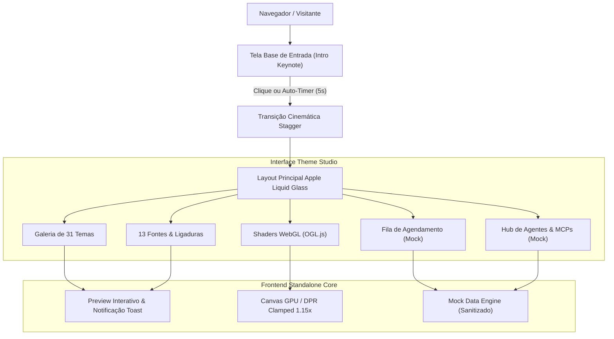

# 🍏 Google Antigravity — Theme Studio & Font Center (Interactive Demo Showcase)

<div align="center">


**Vitrine de demonstração de software de alta fidelidade para o ecossistema Google Antigravity.**  
Projetada com arquitetura visual **Apple Liquid Glass**, motor gráfico de **Shaders WebGL procedurais (OGL.js)**, animação coreografada em cascata e catálogo completo de personalização.

[✨ Acessar Demonstração](#-visão-geral-da-demonstração) • [🎨 Catálogo de Temas](#-catálogo-de-31-temas-de-elite) • [🔤 Fontes Pro](#-catálogo-de-13-fontes-com-ligaduras) • [🔮 Shaders WebGL](#-motor-de-shaders-webgl-ogljs) • [🏛️ Arquitetura](#️-arquitetura-e-engenharia) • [🚀 Como Executar](#-como-executar-a-demo-localmente)

</div>

---

## 📌 Aviso Oficial de Demonstração (Frontend-Only)

> [!IMPORTANT]
> **Esta é uma instância de demonstração interativa desacoplada (Frontend-Only) para exibição de portfólio profissional de software.**  
> O aplicativo executa **100% no navegador**, sem conexão ativa com o servidor local CDP na porta 48123 ou com o sistema de arquivos da máquina hospedeira.  
>  
> **Comportamento da Demo**: A seleção de temas ou fontes atualiza a interface, os cartões visuais, o preview de código com ligaduras tipográficas e as badges de status. **Nenhuma alteração é efetuada em arquivos de sistema ou editores reais**, preservando a segurança, integridade e isolamento do visitante.

---

## ✨ Destaques da Experiência Demonstrativa

### 1. 🎬 Tela Base & Animação Coreografada de Entrada
- **Abertura Apple Keynote / visionOS**: O visitante é recepcionado por um cartão translúcido sobre fundo etéreo com desfoque de 48px, apresentando os pilares do ecossistema e o aviso de escopo.
- **Entrada em Cascata (Smooth Stagger Animation)**: Ao clicar em *Explorar Demonstração* (ou após o temporizador automático de 5s), a tela de introdução desvanece suavemente com blur out e a interface principal é revelada:
  - Sidebar lateral desliza suavemente da esquerda.
  - Topbar superior desce com efeito de refração de vidro.
  - Os **31 cartões de temas** e as **13 fontes** surgem em cascata sequencial escalonada (`stagger delay: 20ms`), gerando impacto visual refinado e fluido.

### 2. 🎨 Catálogo Completo de 31 Temas de Elite
Distribuídos estrategicamente em 3 categorias cromáticas refinadas:
- **Full Monocromáticos (6)**: Contraste absoluto, saturação vibrante e estética Cyberpunk/CRT (Matrix Phosphor, Cyberpunk Neon, Cyberpunk Yellow, Monokai Vibrant, Synthwave 84, Nord Frost).
- **Dark Velvet Tinted (11)**: Bases escuras aveludadas (`#080616` a `#181311`) com matizes ultra-sutis (Basalt Copper, Matcha Obsidian, Tokyo Coral, Ultraviolet Velvet, Dracula Velvet, Cappuccino Velvet, etc.).
- **Light Luminary (14)**: Superfícies claras puras com legibilidade cristalina e paletas solares (Pistachio Gelato, Tuscan Terracotta, Alpine Azure, Sakura Cloud, etc.).

### 3. 🔤 13 Fontes de Código com Ligaduras Nativas
Renderização e preview interativo de tipografias de ponta com suporte a ligaduras tipográficas (`font-variant-ligatures: normal; font-feature-settings: "liga" on, "calt" on;`):
- **JetBrains Mono, Fira Code, Cascadia Code, Victor Mono (itálico cursivo), Source Code Pro, Hack, Inconsolata, Geist Mono, IBM Plex Mono, Space Mono, Ubuntu Mono, DM Mono e SF Pro Apple**.

### 4. 🔮 Motor de Shaders Procedurais WebGL (OGL.js)
Backgrounds animados gerados matematicamente via GPU com DPR Clamping inteligente (`1.15x`) para economia de mais de 60% de energia em telas Retina:
- **Apple Aurora**: Ondas luminescentes fluidas inspiradas no macOS.
- **Cyber Neon**: Malha vetorial e pulso de luz retro-futurista.
- **Deep Cosmos**: Partículas galácticas em órbita tridimensional.
- **Liquid Plasma**: Deformação fluida de gradientes em tempo real.
- **Void Minimal**: Minimalismo estético e gradiente esférico suave.
- **Quantum Wave**: Curvas de probabilidade e interferência quântica.

### 5. ⚡ Agendador, Agentes & Hub MCP com Dados Mock Sanitizados
- Para resguardar a privacidade e oferecer uma demonstração rica, todas as abas que dependem de chamadas ao backend local (`Scheduler`, `Agentes`, `Skills` e `Servidores MCP`) são alimentadas por um **Mock Data Engine** consistente:
  - Fila de tarefas ativas e histórico com badges de execução.
  - 6 personas completas de agentes com papéis, ferramentas e diretrizes.
  - 12 skills de ponta categorizadas com busca em tempo real.
  - Servidores MCP populados com status de conectividade e comandos sandbox.

---

## 🏛️ Arquitetura e Engenharia



---

## 🚀 Como Executar a Demo Localmente

Por ser 100% estática e frontend-only, a demonstração não exige nenhuma instalação de runtime backend:

### Opção 1: Abrir Diretamente no Navegador
Dê um duplo clique no arquivo [`index.html`](file:///Users/mcp/.gemini/antigravity/scratch/antigravity-theme-changer-demo/index.html) ou arraste-o para o Google Chrome, Brave, Safari ou Edge.

### Opção 2: Servidor HTTP Local (Python ou Node)
Caso deseje rodar através de um servidor local leve:

```bash
# Com Python 3
python3 -m http.server 8080

# Ou com Node.js
npx serve .
```

Acesse: **[http://localhost:8080](http://localhost:8080)**

---

## 👨‍💻 Autoria & Portfólio

- **Autor**: Mateus Celestino
- **GitHub**: [@MateusCelestinoProX](https://github.com/MateusCelestinoProX)
- **Licença**: MIT
