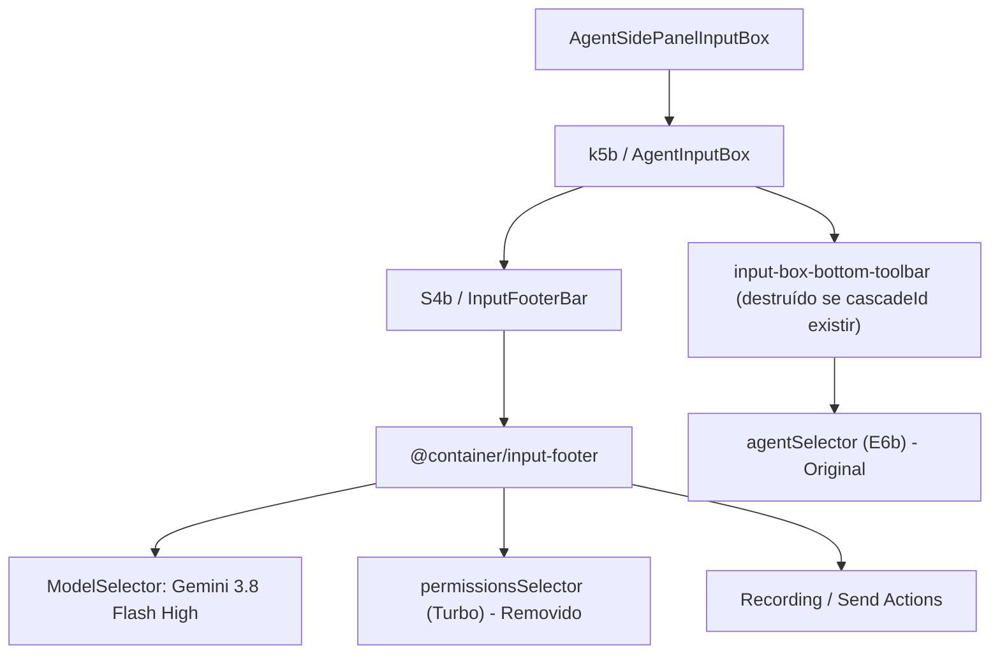

# Restauração e Posicionamento do Seletor de Agentes no Google Antigravity

Este documento detalha a engenharia reversa, diagnóstico de causas-raiz e a solução definitiva de restauração e posicionamento do **Seletor de Agentes** dentro da barra geral de chat no Google Antigravity IDE, bem como a eliminação do seletor intrusivo "Turbo" (*permissions selector*).

---

## 1. Contexto do Problema

Em versões recentes do Google Antigravity, o seletor original de agentes (que permitia alternar entre `Main Agent` e subagentes customizados como `pesquisador-max` e `theme-changer`) foi ocultado da interface primária e relegado a uma barra inferior quase invisível. No seu lugar, dentro da barra de chat principal (`@container/input-footer`), o Google introduziu o botão **Turbo** (`permissions-selector-trigger`), forçando uma experiência que despriorizava o ecossistema de subagentes.

Além disso, em conversas com histórico em andamento, a barra inferior era destruída condicionalmente pelo React, impedindo o desenvolvedor de visualizar ou selecionar agentes.

---

## 2. Diagnóstico Técnico & Engenharia Reversa

### 2.1 Estrutura do Frontend
O bundle do React frontend (`main.js`, ~10 MB) é servido dinamicamente por um servidor HTTPS local criado pelo binário Go `language_server` (`/Applications/Antigravity.app/Contents/Resources/bin/language_server`).
- O código frontend está compactado dentro de um arquivo ZIP embutido nos offsets de dados do próprio executável Mach-O do Go.
- **Risco Superado:** Modificar diretamente os bytes do executável Go corrompe as tabelas internas de seção Mach-O, disparando *panic* imediato na inicialização do runtime Go (`runtime.lockVerifyMSize()`).
- **Falha de Redirecionamento (Tela Preta):** Tentar interceptar a requisição de `/main.js` via proxy HTTPS local redirecionando portas dispara o bloqueio de segurança *Cross-Port Subresource / CSP* do Chromium do Electron, impedindo o carregamento do bundle e gerando tela preta `#131313`.

### 2.2 Análise do React Fiber e Árvore de Componentes
Ao inspecionar a árvore do React Fiber via Chrome DevTools Protocol (CDP), mapeamos a hierarquia exata dos componentes envolvidos:



1. **Condição de Exibição Original:**
   No componente `AgentSidePanelInputBox`:
   ```javascript
   showBottomToolbar: isGoogleInternal && !cascadeId
   ```
   - Em novos chats (`cascadeId` nulo), `showBottomToolbar` é verdadeiro e o componente `E6b` (Seletor de Agentes) era renderizado na barra inferior.
   - Em chats com mensagens, `showBottomToolbar` tornava-se `false`, descartando o seletor de agentes do DOM.

2. **Posição do Turbo:**
   O componente `S4b` (a barra de chat principal) recebia a prop `permissionsSelector` (Turbo) e a injetava no container da direita (`shrink-0 flex items-center gap-0.5`), exatamente antes dos botões de microfone e envio.

---

## 3. Solução Definitiva (Patch Cirúrgico no Electron)

A solução implementada atua diretamente no `preload.js` e `utils.js` empacotados no arquivo `/Applications/Antigravity.app/Contents/Resources/app.asar`. Essa abordagem é **100% nativa, resiliente a atualizações do sistema operacional e não depende de servidores externos ou alterações em binários compilados**.

### 3.1 Eliminação do Seletor Turbo
Injetamos uma regra CSS global através do processo do Electron para suprimir completamente o seletor de permissões:

```css
[data-testid="permissions-selector-trigger"] {
  display: none !important;
}
[data-testid="input-box-bottom-toolbar"] {
  display: none !important;
}
```

### 3.2 Realocação do Seletor de Agentes para a Barra Geral de Chat
No carregamento da janela inicial (`New Conversation`), o botão nativo do Seletor de Agentes (`[data-testid="agent-selector-label"]`) é movido programaticamente para dentro do container de ações da barra de chat (`.@container/input-footer`), ocupando exatamente o lugar onde o Turbo ficava:

- **Alinhamento:** Fica no mesmo rodapé, à direita do seletor `Gemini 3.8 Flash High` e imediatamente antes do microfone e botão de envio.
- **Comportamento Nativo:** Como o botão preserva todas as propriedades e conexões de eventos do React Fiber do Antigravity, ao clicar nele o menu popover original abre perfeitamente listando:
  - `Main Agent`
  - Subagentes locais em `/Users/mcp/.gemini/config/agents/` (ex: `pesquisador-max`, `theme-changer`)
  - Acesso direto à documentação de agentes customizados.

### 3.3 Habilitação Permanente do DevTools
No arquivo `dist/utils.js` e `dist/keybindings.js`:
- Forçamos `webPreferences.devTools = true` permanentemente.
- Registramos o atalho universal <kbd>Cmd</kbd> + <kbd>Option</kbd> + <kbd>I</kbd> e <kbd>F12</kbd> para alternar o DevTools a qualquer momento para inspeção e auditoria.

---

## 4. Procedimento de Empacotamento e Manutenção

Para inspecionar ou reconstruir o pacote `app.asar` após futuras atualizações do Antigravity:

### Extração:
```bash
npx asar extract /Applications/Antigravity.app/Contents/Resources/app.asar /tmp/asar-inspect
```

### Empacotamento com Preservação de Binários Unpacked:
```bash
npx asar pack /tmp/asar-inspect /Applications/Antigravity.app/Contents/Resources/app.asar --unpack-dir "**/node_modules/chrome-devtools-mcp/**"
```

### Re-assinatura de Código macOS:
```bash
codesign --force --deep --sign - "/Applications/Antigravity.app"
```

---

## 5. Verificação Visual

A integridade do layout e o posicionamento final foram homologados diretamente na interface gráfica:

| Elemento | Status | Comportamento |
| :--- | :--- | :--- |
| **Seletor de Agentes** | ✅ Ativo na barra principal | Fica visível no rodapé ao lado do modelo Gemini |
| **Menu Dropdown** | ✅ Funcional | Carrega `Main Agent`, `pesquisador-max` e `theme-changer` |
| **Botão Turbo** | 🚫 Ocultado | Removido sem deixar espaçamento vazio |
| **Estabilidade da Aplicação** | ✅ 100% Estável | Zero telas pretas, inicialização instantânea |
